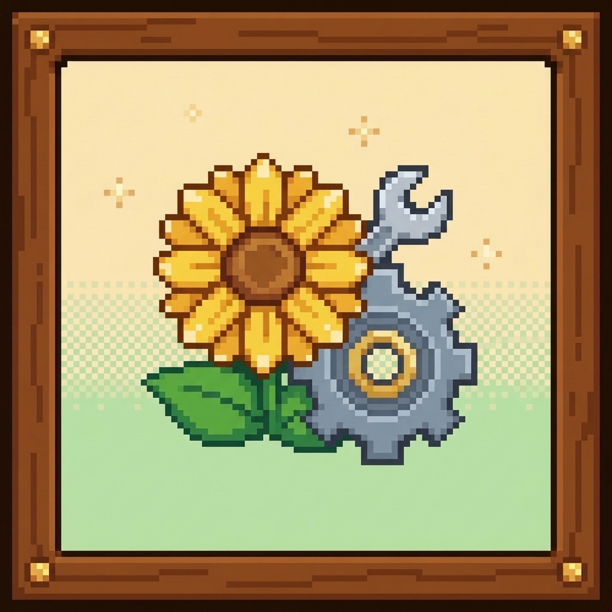

<p align="center">
  
</p>

<h1 align="center">Garden Launcher (Mod Garden for iOS)</h1>

<p align="center">
  <b>Native iOS Mod Manager, Touch UI Customizer, RAM Saver &amp; Launcher Framework for Stardew Valley on iOS (SDViosport + SMAPI)</b><br/>
  <i>Trình quản lý Mod, tối ưu RAM, tùy chỉnh nút cảm ứng &amp; giao diện chuẩn Apple iOS cho Stardew Valley trên iPhone/iPad (iOS 14 – iOS 26+, không cần JIT)</i>
</p>

---

> **⚠️ Thông báo bản quyền / Legal & Copyright Notice**
>
> Kho mã nguồn này **KHÔNG chứa bất kỳ tệp game có bản quyền nào của Stardew Valley / ConcernedApe** (không có `Content/`, `.xnb`, `.xwb`, `Stardew Valley.dll`) và không chứa mod bên thứ ba. Người dùng phải tự cung cấp tệp game **Stardew Valley PC v1.6.15** bản quyền hợp pháp của chính mình (Steam / GOG) để nhập vào ứng dụng.
>
> *This repository contains **zero copyrighted Stardew Valley game files** and zero third-party mods. You must legally own Stardew Valley PC (v1.6.15) and supply your own game files.*

---

## ✨ Tính năng nổi bật (v6 / v1.6.22)

- **Giao diện chuẩn Apple iOS (`AppleTheme.m`)**: Thiết kế theo Apple Human Interface Guidelines (SF Pro + số `monospacedDigit`, SF Symbols dạng squircle giống ứng dụng Cài đặt iOS, tự động Light/Dark Mode, thanh bên trong suốt `SystemChromeMaterial`, bảng `Inset Grouped`, HUD nổi dạng kính mờ).
- **Khóa độ phân giải nguyên `2.0×` sắc nét (`patch_perf_v6.ps1`)**: Khắc phục triệt để lỗi lệch khung hình ở tỷ lệ lẻ (`1.5×`) do `iOSGameWindow.get_ClientBounds()` cắt phần thập phân trong MonoGame; hiển thị đầy màn hình sắc nét, ổn định trên mọi iPhone/iPad.
- **Bộ tối ưu RAM 4 lớp (giảm ~200–500 MB RSS)**:
  1. **WaveBank Audio Eviction (`MonoGame.Framework.dll`)**: Tự động giải phóng buffer nhạc nền OpenAL PCM (`>= 512 KB`) đã ngừng phát (`AL.DeleteBuffer`) mỗi khi chuyển bài.
  2. **Mono SGen Soft Heap Limit (`Info.plist`)**: Cấu hình `MONO_GC_PARAMS=nursery-size=4m,soft-heap-limit=384m,evacuation-threshold=66` giúp thu gom rác sớm, giảm nguy cơ iOS Jetsam thoát game.
  3. **Tắt prewarm tilesheet mặc định (`EnableWarpTilesheetPrewarm = false`)**: Tránh nạp trước hàng loạt texture khi chuyển bản đồ, tiết kiệm VRAM.
  4. **Dọn RAM thủ công & giảm lag menu (`SDViOSTouchControls.dll`)**: Nút **"Dọn RAM ngay"** gọi `PruneTileSheets` trước khi nén Gen2 GC; loại bỏ `Environment.StackTrace` thừa khi mở menu và giảm tần suất quét config UI.
- **Tương thích iOS 14 – iOS 26+ (0% JIT)**:
  - Sử dụng `UIWindowScene` (`connectedScenes` + `keyWindow`), an toàn popover trên iPadOS 26, không dùng API đã loại bỏ (`UIApplication.windows` / `UIScreen.mainScreen`).
  - Chạy hoàn toàn bằng **Mono Interpreter (0% JIT)** — tương thích sideload thường (KSign, AltStore, SideStore, TrollStore) và không bị ảnh hưởng bởi iOS 26 TXM.
- **Quản lý Mod & Sao lưu an toàn (`Garden.m`, `History.m`)**:
  - Cài mod `.zip` trực tiếp trong ứng dụng (dùng `miniz`), tự xử lý JSON5 cho iOS 14+, kiểm tra xung đột và lưu nhật ký kiểm tra **SHA-256** cho phép hoàn tác (Rollback) an toàn.
- **Tùy chỉnh nút cảm ứng trực tiếp (Live HUD) (`Embedded.m`, `UiConfig.m`, `patch_menubar.ps1`)**:
  - Chỉnh kích thước, vị trí, độ mờ của MenuBar, nút `X/Y/A/B`, `LT/RT`, Joystick và hộp thoại ngay trong game.
- **Hỗ trợ Co-op LAN / Direct IP (`patch_lidgren.ps1`)**:
  - Vá `Lidgren.Network.dll` bổ sung `SO_REUSEADDR` không điều kiện để mở lại phòng nhanh trên iOS mà không gặp lỗi `AddressAlreadyInUse`, kèm trình dò IPv4 nội bộ.
- **Theo dõi RAM, FPS & Nhiệt độ theo thời gian thực (`RamMonitor.m`)**:
  - Đọc trực tiếp từ kernel iOS (`task_vm_info` + `os_proc_available_memory`) với thanh pill kính mờ có thể kéo thả.

---

## 📁 Cấu trúc mã nguồn

```text
GardenLauncher-iOS/
├── ModGarden/
│   ├── AppleTheme.m              # Hệ màu & component UI chuẩn Apple iOS (Light/Dark)
│   ├── Embedded.m                # Framework nhúng trong game: pass-through overlay & Live HUD
│   ├── Garden.m                  # Trình cài/gỡ mod ZIP (miniz), xử lý JSON5, nhập game PC
│   ├── History.m                 # Nhật ký cài đặt kiểm chứng SHA-256 & hoàn tác an toàn
│   ├── main.m                    # Màn hình chính Split-View (Mod, Co-op, UI, Hiệu năng/RAM)
│   ├── RamMonitor.m              # Pill đo RAM / FPS / Thermal (task_vm_info)
│   ├── UiConfig.m                # Lưu trữ cấu hình nút cảm ứng & HUD
│   ├── Info.plist                # Manifest cho bản ứng dụng độc lập
│   ├── orchard.png               # Biểu tượng nhỏ trong giao diện
│   ├── GardenLauncherIcons/      # Bộ AppIcon đầy đủ cho iPhone & iPad
│   └── vendor/                   # miniz (MIT License)
├── scripts/
│   ├── patch_menubar.ps1         # Mono.Cecil IL patch cho thanh MenuBar & nút cảm ứng
│   ├── patch_lidgren.ps1         # Mono.Cecil IL patch cho UDP socket & Co-op LAN iOS
│   ├── patch_perf_v6.ps1         # Mono.Cecil IL patch: khóa 2.0x, chống lag menu & giảm RAM
│   └── package_embedded.py       # Tiêm dylib vào Mach-O, cấu hình Info.plist & đóng gói --launcher IPA sạch
└── assets/
    ├── Garden-Launcher-Icon.png
    └── Huong-Dan-Cai-Mod-Stardew-Mobile.jpg
```

---

## 🛠️ Hướng dẫn Build từ mã nguồn (Windows / macOS)

### Yêu cầu
- **Base IPA** từ dự án nguồn mở [SDViosport](https://github.com/DeadAKJ/SDViosport) (để lấy runtime `SDViOS`, `SDViOS.dll`, `MonoGame.Framework.dll`, `SDViOSTouchControls.dll` và SMAPI nguồn mở).
- **Trình biên dịch iOS ARM64**:
  - Trên **Windows**: `zig cc` (target `aarch64-ios`) + `iPhoneOS.sdk` + `zsign.exe`.
  - Hoặc trên **macOS**: Xcode (`clang -arch arm64 -isysroot $(xcrun --sdk iphoneos --show-sdk-path)`).
- **PowerShell 5.1+ / 7+** và `Mono.Cecil.dll` (để chạy các script vá IL).
- **Python 3.10+** (để chạy `scripts/package_embedded.py`).

### Bước 1: Biên dịch `SDVModGarden` framework (ARM64 iOS)

Ví dụ biên dịch chéo trên Windows bằng `zig cc`:

```powershell
$zig = "path\to\zig.exe"
$sdk = "path\to\iPhoneOS16.5.sdk"

& $zig cc -target aarch64-ios -miphoneos-version-min=14.0 `
  -isysroot $sdk -isystem "$sdk\usr\include" `
  -F"$sdk\System\Library\Frameworks" `
  -fobjc-arc -Os -dynamiclib `
  -install_name "@executable_path/Frameworks/SDVModGarden.framework/SDVModGarden" `
  "-Wl,-headerpad_max_install_names" `
  -framework Foundation -framework UIKit -framework QuartzCore `
  -framework CoreGraphics -framework UniformTypeIdentifiers `
  -o build\SDVModGarden `
  ModGarden\Embedded.m ModGarden\vendor\miniz.c
```

### Bước 2: Chạy các bản vá IL (Mono.Cecil)

Trích xuất `SDViOS.dll` (`clean-host.dll`), `SDViOSTouchControls.dll` (`clean-touch.dll`), `MonoGame.Framework.dll`, và `Lidgren.Network.dll` vào thư mục làm việc (`$WorkDir`), sau đó chạy lần lượt:

```powershell
.\scripts\patch_menubar.ps1 -WorkDir $WorkDir -CecilDll $CecilDll
.\scripts\patch_perf_v6.ps1 -WorkDir $WorkDir -CecilDll $CecilDll
.\scripts\patch_lidgren.ps1 -WorkDir $WorkDir -CecilDll $CecilDll -SrcPath "$WorkDir\Lidgren.Network.dll"
```

### Bước 3: Đóng gói Launcher IPA sạch (0% tệp game bản quyền)

Cờ `--launcher` tự động loại bỏ toàn bộ `BundledGame/` & `BundledCompatibility/`, chỉ giữ lại runtime và SMAPI nguồn mở (LGPL-3.0), tiêm `SDVModGarden.framework`, ghi cấu hình `MONO_GC_PARAMS` & quyền Local Network, rồi kiểm tra toàn vẹn SHA-256:

```powershell
python scripts\package_embedded.py --launcher `
  path\to\base-sdvios.ipa `
  build\SDVModGarden `
  path\to\zsign.exe `
  dist\Garden-Launcher-v6.ipa `
  "$WorkDir\v6-host.dll" `
  "$WorkDir\v6-touch.dll" `
  "$WorkDir\lidgren-ios.dll"
```

---

## 📱 Hướng dẫn sử dụng nhanh

<p align="center">
  
</p>

1. Cài đặt file `Garden-Launcher-v6.ipa` lên iPhone/iPad (qua AltStore, SideStore, KSign, TrollStore hoặc Xcode).
2. Mở ứng dụng, nhập thư mục **Stardew Valley PC v1.6.15** bản quyền của bạn (`Content/` + các file `.dll` gốc).
3. Nhấn biểu tượng **MODS** để cài mod `.zip`, tinh chỉnh giao diện cảm ứng, bật HUD theo dõi RAM hoặc tạo phòng Co-op LAN.

---

## 🙏 Ghi công / Credits

- **[ConcernedApe](https://www.stardewvalley.net/)** — Tác giả Stardew Valley.
- **[DeadAKJ / SDViosport](https://github.com/DeadAKJ/SDViosport)** — Runtime Stardew Valley cho iOS (MIT License).
- **[Pathoschild / SMAPI](https://github.com/Pathoschild/SMAPI)** — Stardew Modding API (LGPL-3.0).
- **[Rich Geldreich / miniz](https://github.com/richgel999/miniz)** — Thư viện giải nén ZIP siêu nhẹ (MIT License).

---

## 📄 Giấy phép / License

Phát hành theo giấy phép **[MIT License](LICENSE)**.
