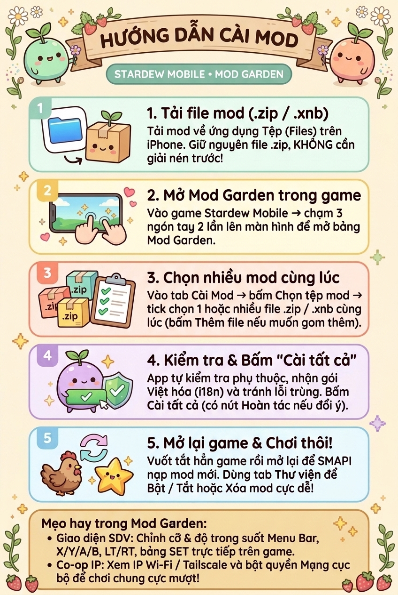

<p align="center">
  
</p>

<h1 align="center">Garden Launcher (iOS)</h1>

<p align="center">
  Trình quản lý Mod, tối ưu RAM &amp; giao diện iOS cho Stardew Valley trên iPhone/iPad (iOS 14 – iOS 26+, không cần JIT).<br/>
  <a href="https://github.com/hanprm9-dot/Garden-Launcher-iOS/releases/latest"><b>⬇️ Tải Garden-Launcher-v6.ipa</b></a>
</p>

> **Lưu ý:** Không kèm tệp game bản quyền Stardew Valley. Cần tự cung cấp dữ liệu **Stardew Valley PC 1.6.15**.

---

## 📲 Hướng dẫn cài đặt

1. **Cài IPA:** Tải [Garden-Launcher-v6.ipa](https://github.com/hanprm9-dot/Garden-Launcher-iOS/releases/latest) và cài lên iPhone/iPad bằng **KSign / ESign / TrollStore / AltStore / SideStore / Sideloadly** (tin cậy chứng chỉ trong *Cài đặt → Quản lý VPN & Thiết bị* nếu được yêu cầu).
2. **Nạp dữ liệu PC `1.6.15` (chỉ làm 1 lần):**
   - **Cách nhanh:** Nén thư mục game **Stardew Valley PC 1.6.15** thành 1 file `.ZIP` → mở **Garden Launcher** → bấm **Nhập gói dữ liệu game (.ZIP)** → chờ 20–40 giây.
   - **Hoặc chép thủ công:** Chép `Content/` và các file `.dll` gốc vào **Tệp → Trên iPhone của tôi → Garden Launcher** → bấm **Kiểm tra lại**.
   - Khi đủ 4 mục màu xanh, **vuốt tắt hẳn app rồi mở lại** để vào game.
3. **Cài Mod & Việt Hóa:** Vào game bấm nút **MODS** (hoặc **chạm 3 ngón tay 2 lần**) → tab **Cài Mod** → chọn 1 hoặc nhiều file `.ZIP` → **Cài đặt** → mở lại app.
4. **Chỉnh nút, RAM & Co-op:**
   - Tab **Hiệu năng & Nút**: bấm **Mở thanh nổi** để chỉnh trực tiếp cỡ/độ mờ nút trong game, bật **HUD RAM/FPS**, hoặc bấm **Dọn RAM ngay** khi chơi mod nặng.
   - Tab **Co-op LAN**: cấp quyền **Mạng cục bộ**, lấy IP máy Host để bạn bè kết nối qua *Co-op → Join LAN Game*.

<p align="center">
  
</p>

---

## ✨ Tính năng chính (v6)

- **Giao diện chuẩn Apple iOS** (SF Pro, SF Symbols, Light/Dark tự động, thanh kính mờ).
- **Khóa độ phân giải `2.0×` sắc nét**, không lệch màn hình, giảm ~55% tải GPU.
- **Tối ưu RAM 4 lớp**: tự xả buffer nhạc nền OpenAL khi chuyển bài, giới hạn heap Mono SGen (`384m`), tắt prewarm tilesheet mặc định và dọn RAM thủ công ngay trong game.
- **Tương thích iOS 14 – iOS 26+ (0% JIT)** — chạy thuần Mono Interpreter, cài sideload thường không cần JIT.
- **Quản lý Mod an toàn**: cài nhiều `.ZIP` cùng lúc, hỗ trợ Việt Hóa `i18n`/`.xnb`, bật/tắt nhanh và hoàn tác (Rollback) có kiểm tra SHA-256.
- **Co-op LAN / Direct IP**: vá `Lidgren.Network` (`SO_REUSEADDR`) giúp tạo lại phòng nhanh trên iOS.

---

<details>
<summary><b>🛠️ Build từ mã nguồn (dành cho lập trình viên)</b></summary>

Yêu cầu: base IPA từ [SDViosport](https://github.com/DeadAKJ/SDViosport), `zig cc` + `iPhoneOS.sdk` (hoặc Xcode), `zsign`, `Mono.Cecil.dll`, Python 3.10+.

```powershell
# 1. Biên dịch SDVModGarden.framework (ARM64 iOS 14+)
& $zig cc -target aarch64-ios.14.0-none `
  -isysroot $sdk -isystem "$sdk\usr\include" `
  -F"$sdk\System\Library\Frameworks" -L"$sdk\usr\lib" `
  -fobjc-arc -Os -dynamiclib `
  -install_name "@executable_path/Frameworks/SDVModGarden.framework/SDVModGarden" `
  "-Wl,-headerpad_max_install_names" `
  -framework Foundation -framework UIKit -framework QuartzCore `
  -framework CoreGraphics -framework UniformTypeIdentifiers `
  -o build\SDVModGarden ModGarden\Embedded.m ModGarden\vendor\miniz.c

# 2. Vá IL (Mono.Cecil)
.\scripts\patch_menubar.ps1 -WorkDir $WorkDir -CecilDll $CecilDll
.\scripts\patch_perf_v6.ps1 -WorkDir $WorkDir -CecilDll $CecilDll
.\scripts\patch_lidgren.ps1 -WorkDir $WorkDir -CecilDll $CecilDll -SrcPath "$WorkDir\Lidgren.Network.dll"

# 3. Đóng gói IPA Launcher sạch (0% tệp game bản quyền)
python scripts\package_embedded.py base-sdvios.ipa build\SDVModGarden zsign.exe dist\Garden-Launcher-v6.ipa `
  "$WorkDir\v6-host.dll" "$WorkDir\v6-touch.dll" "$WorkDir\lidgren-ios.dll"
```

</details>

---

**Credits:** [ConcernedApe](https://www.stardewvalley.net/) · [SDViosport](https://github.com/DeadAKJ/SDViosport) (MIT) · [SMAPI](https://github.com/Pathoschild/SMAPI) (LGPL-3.0) · [miniz](https://github.com/richgel999/miniz) (MIT) — Phát hành theo [MIT License](LICENSE).
